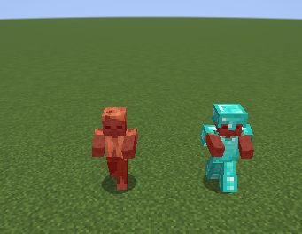
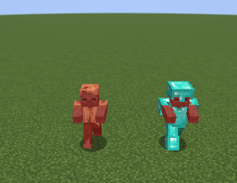
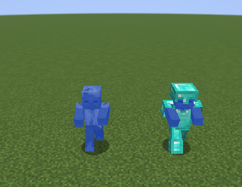
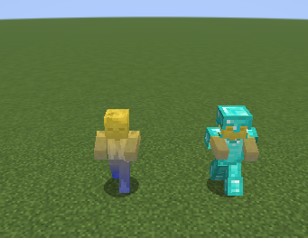
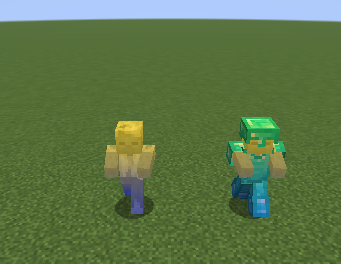
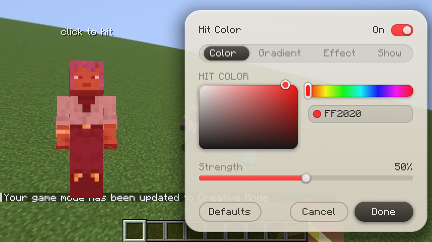
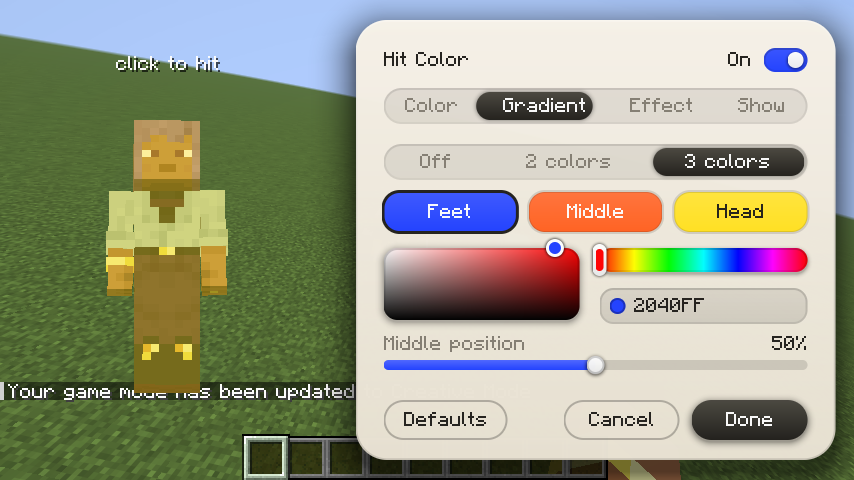
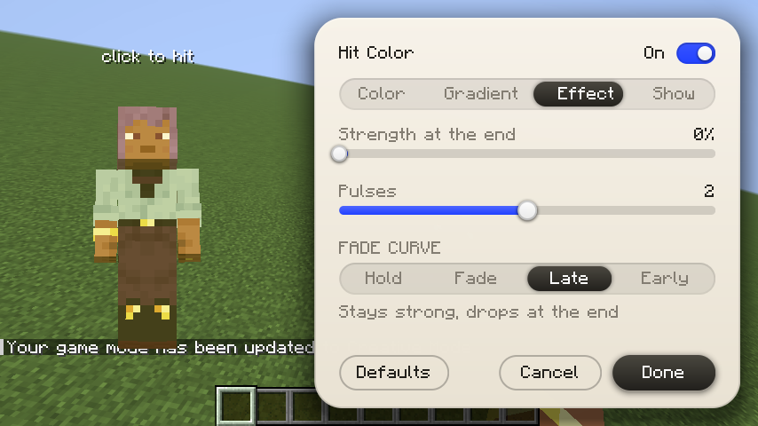
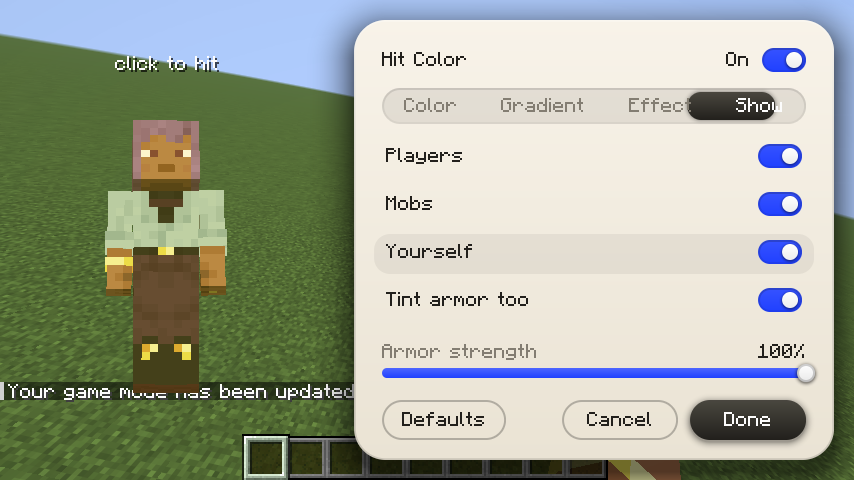

# Hit Color

change the red flash on mobs and players when they get hit. pick any color, a gradient from the feet to the head, and shape how the flash fades.

client side fabric mod for 1.21.11, 26.1 and 26.2. press **H** to open the settings (press it again to close, rebind it in Controls), or use Mod Menu. the settings menu is built into the mod, it only needs fabric api.

- **color**: any color with a hex field, and a strength slider
- **gradient**: two or three colors blended from the feet to the head, with a slider for where the middle color sits
- **fade**: hold, fade, late or early curves, a strength at the end of the flash, and up to four pulses
- **armor**: tint the armor too, with its own strength
- **show on**: players, mobs and yourself separately

the settings screen shows your own player model with your skin. it takes a hit every three seconds, so every change shows up on the real thing at once.

## download

| jar | minecraft |
|---|---|
| `hit-color-mc1.21.11-1.2.0.jar` | 1.21.11 |
| `hit-color-mc26.1-1.2.0.jar` | 26.1 |
| `hit-color-mc26.2-1.2.0.jar` | 26.2 |

on the releases page. fabric loader 0.16 or newer, fabric api.

## pictures

| vanilla | default | blue |
|---|---|---|
|  |  |  |

| gradient | gradient with armor |
|---|---|
|  |  |

| color | gradient |
|---|---|
|  |  |

| effect | show |
|---|---|
|  |  |

## why it does not lag

- the flash is the game's own hit overlay, the mod only changes its colors, so there is no extra drawing
- the overlay colors are rewritten only when you change a setting
- when the mod is off it does nothing

all rights reserved. made by wysss.
